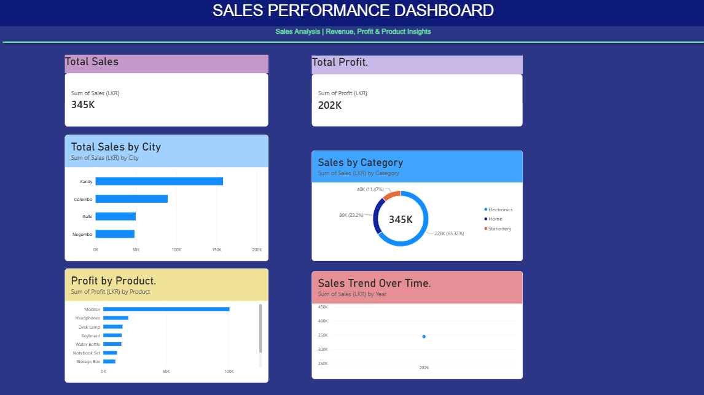

# Sales Performance Dashboard | Power BI

## About the Project
This is my beginner Power BI project, created to practice data analysis and dashboard development. The dashboard explores sales and profit performance across different cities and product categories.

## Objectives
- Analyze total sales and profit.
- Compare sales performance across cities.
- Understand sales contributions by product category.
- Identify products generating the most profit.
- Explore sales trends over time.

## Tools Used
- Microsoft Power BI Desktop
- Excel

## Dashboard Features
- Total Sales KPI card
- Total Profit KPI card
- Sales by City column chart
- Sales by Category donut chart
- Profit by Product bar chart
- Sales Trend Over Time line chart

## Skills Practiced
- Data visualization
- Creating KPI cards
- Building interactive reports
- Analyzing sales and profit data
- Designing a dashboard

## Project Files
- `Sales_Analysis_Dashboard.pbix` — Power BI report file.

## Learning Outcome
Through this project, I practiced transforming sales data into visual insights and building a dashboard using Power BI.

## Author
Information Systems Undergraduate | Aspiring Data Analyst

## Dashboard Preview

